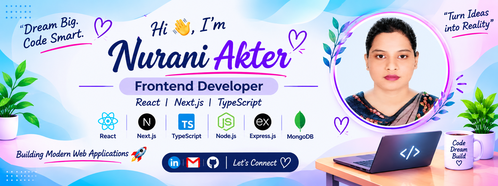

<div align="center">
  
</div>
<h1 align="center">Hi 👋, I'm Nurani Akter</h1>

<h3 align="center">Frontend Developer | React | Next.js | TypeScript</h3>

<p align="center">
  Passionate about building modern, responsive, and user-friendly web applications.
</p>
 
---

## 👩‍💻💻 About Me  

Hi! I'm **Nurani Akter**, a passionate Frontend Developer who loves turning ideas into beautiful, responsive, and user-friendly web applications.

I enjoy working with modern web technologies and continuously improving my development skills. I focus on writing clean, maintainable code and creating smooth user experiences.

- 💻 Skilled in **HTML, CSS, JavaScript, React, and Tailwind CSS**
- ⚛️ Exploring **Next.js and TypeScript**
- 🌱 Learning and practicing **Node.js, Express.js, and MongoDB**
- 🚀 Building real-world projects to strengthen my development skills
- 🎯 Aspiring to become a professional Frontend Developer
- 🤝 Open to collaboration, learning opportunities, and exciting projects

I believe in continuous learning, solving problems, and growing as a developer every day.

**Let's connect and build something amazing together!**

---

## 🌐 My Portfolio

🚀 Check out my personal portfolio to explore my skills, projects, and experience.

<p align="left">
  <a href="https://nurani-akter-portfolio.vercel.app/" target="_blank">
    
  </a>
</p>

---

## 🛠️ Tech Stack  

### **Frontend**


### **Backend**


### **Tools & Others**


---

## 🌐 Connect With Me  

[](https://www.linkedin.com/in/nurani-akter-47b94b381)
[](mailto:nuraniakter828@gmail.com)

---

## 📊 GitHub Stats

<p align="center">
  
</p>

<p align="center">
  
</p>

<p align="center">
  
</p>
 

---

## 🎯 My Coding Journey

- 🌱 Learning modern web development with **Next.js and TypeScript**
- 💻 Building real-world projects to improve my practical skills
- 🔐 Exploring authentication with **Better Auth**
- 🗄️ Practicing database management with **MongoDB**
- ⚛️ Improving my skills in **React and JavaScript**
- 🚀 Working towards becoming a professional **Frontend Developer**

---

## 📚 Currently Learning

- ⚛️ Advanced React Concepts
- 🔷 TypeScript
- ▲ Next.js
- 🟢 Node.js & Express.js
- 🍃 MongoDB
- 🔐 Authentication with Better Auth

**Always exploring new technologies and improving my development skills!** 🚀

---

## 🚀 Featured Projects

### 🏋️ FitLog

A fitness tracking web application where users can explore workouts, manage their daily plans, and save exercises for later.

**Tech Stack:** `Next.js` · `TypeScript` · `Tailwind CSS`

[](YOUR_LIVE_LINK) [](YOUR_GITHUB_LINK) 


### 🧱 Dev Stack Builder

A modern application that allows users to explore different development technologies and build their own technology stack.

**Tech Stack:** `React` · `TypeScript` · `Tailwind CSS` · `Vite`

[](https://react-assignment-05-project.netlify.app/) [](YOUR_GITHUB_LINK) 


### ☕ Coffee Shop Website

A modern and responsive coffee website featuring an attractive user interface and smooth browsing experience.

**Tech Stack:** `React` · `JavaScript` · `Tailwind CSS`

[](YOUR_LIVE_LINK) [](YOUR_GITHUB_LINK) 


### 🌐 DevConf 2026

A modern developer conference and hackathon landing page featuring event information, hackathon details, and registration section.

**Tech Stack:** `HTML` · `CSS` · `JavaScript`

[](YOUR_LIVE_LINK) [](YOUR_GITHUB_LINK) 

---

## 📌 Current Goals

- 🟨 Improve my JavaScript skills
- 🔷 Improve my TypeScript skills
- ⚛️ Build more React and Next.js projects
- 🖥️ Improve backend development skills
- 🍃 Learn MongoDB deeply
- 🔐 Practice authentication systems
- 🚀 Build full-stack web applications
- 🌍 Deploy more real-world projects

---

## 💻 Projects I'm Working On

```text
🏋️ FitLog
   └── Next.js + TypeScript + Tailwind CSS

🧱 Dev Stack Builder
   └── React + TypeScript + Tailwind CSS + Vite

☕ Coffee Shop Website
   └── React + JavaScript + Tailwind CSS

🌐 DevConf 2026
   └── HTML + CSS + JavaScript

🔐 Authentication Practice
   └── Better Auth + MongoDB + Next.js
```

---

## 🐍 My GitHub Contributions

<p align="center">
  
</p>

---
 
<p align="center">
  
</p>

---

<h3 align="center">✨ Thanks for Visiting My GitHub Profile! ✨</h3>

<p align="center">
  <i>Every line of code is a new step towards something amazing.</i>
</p>

<p align="center">
  🌱 Keep Learning &nbsp; | &nbsp; 💻 Keep Building &nbsp; | &nbsp; 🚀 Keep Growing
</p>

<p align="center">
  <b>Dream Big. Code Smart. Make an Impact. 💙</b>
</p>

---
